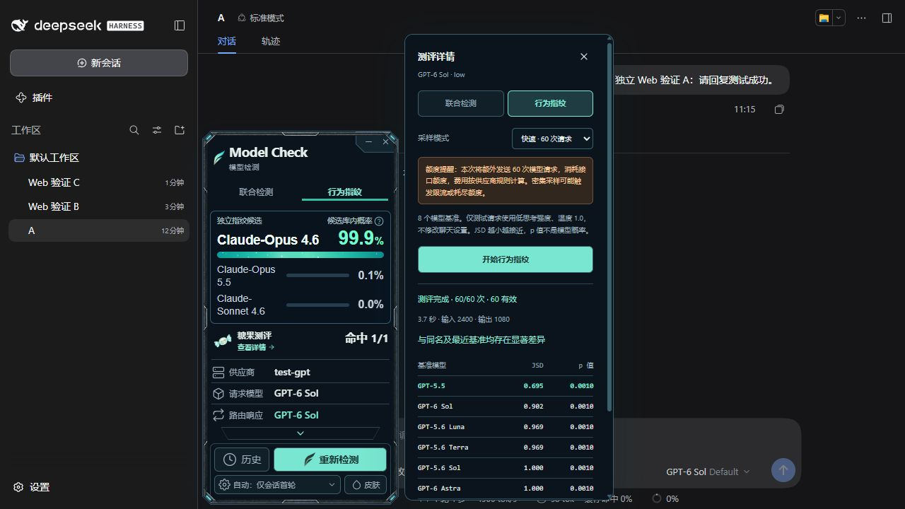

# 桌面与 Web 兼容性

Model Check **0.1.0** 使用同一个 npm 包支持 DeepSeek Harness 桌面版与独立 Web 版。安装目标按 profile 区分：桌面为 `desktop`，Web 为 `web`。

## 安装

桌面版使用 DSH 桌面安装附带的 CLI：

```sh
dsh plugin --profile desktop add dsh-model-check --ignore-scripts
```

独立 Web 版使用 Web 运行环境中的 CLI：

```sh
dsh plugin --profile web add dsh-model-check --ignore-scripts
```

未配置 `dsh` 命令时，可以使用 `npx @deepseek-ai/dsh plugin --profile web add dsh-model-check --ignore-scripts`。安装后重启对应的 DSH 进程；Web 版还需刷新浏览器。桌面 profile 由桌面运行时管理，npm 版 CLI 不负责管理它。

要求 DSH ≥ 0.2.0-rc.2。独立 Web 服务需要 Node.js ≥ 22，插件随服务运行，浏览器无需单独安装扩展。

## 独立 Web 验证

验证日期：2026-10-13。使用从 npm 安装的 `dsh-model-check@0.1.0` 和 `@deepseek-ai/dsh@0.2.0-rc.2`，在 Windows、Node.js 24.20.0 下启动独立 Web 服务。测试使用隔离的 `DSH_HOME` 和本地 OpenAI 兼容 HTTP/SSE 模拟接口，不依赖 Electron 桌面宿主。

| 检查项 | 结果 |
| --- | --- |
| npm 包名安装、后端加载、浏览器组件加载 | 通过；44 个运行文件与仓库一致 |
| 联合检测 | 3 次数字指纹与 1 次糖果题并行完成，最多 4 个请求同时运行 |
| 行为指纹 | 快速模式 60/60 次完成，60 个有效模拟样本 |
| 最小化与取消 | 最小化时仍能完成；取消后 4 个在途 HTTP 请求均中止 |
| 会话与频率 | 3 个会话隔离；“仅会话首轮”不在第二轮重复检测 |
| 重启恢复 | 会话对应的检测记录恢复正常 |
| 请求与响应标签 | 能分别展示，响应标签不同时仍按请求模型执行限制 |
| Gemini 行为指纹限制 | 界面禁用；后端返回 `GEMINI_BEHAVIOR_DISABLED`，没有追加模型请求 |
| 外观与窗口 | 皮肤、跟随 DSH 明暗主题、两侧吸附、展开悬钮拖动均通过 |
| 展开详情 | 既有内容相对位置不变；窗口接近屏幕底部时会整体上移以保持可见 |
| 浏览器错误 | 0 个控制台错误 |

验证共使用 **91 次本地模拟请求**，其中 4 次按取消操作中止，没有调用真实模型、没有消耗供应商额度。上表验证安装与功能兼容性，不评估模型识别准确率。未覆盖远程部署、HTTPS 反向代理、子路径部署、其他操作系统或浏览器内核，以及原生 Anthropic / Gemini 协议。

下图是独立 DSH Web 中的实际插件界面；概率和行为比较来自模拟输入，不代表真实模型测评。



## 数据与配置

- 插件后端使用 DSH 当前会话供应商，检测请求由 DSH 服务发送，无需浏览器保存 API Key。
- 检测记录默认保存到 `$DSH_HOME/model-check/state.json`，未设置 `DSH_HOME` 时使用 `~/.dsh/model-check/state.json`，可通过 `MODEL_CHECK_DATA` 指定目录。
- profile 区分安装位置，但默认历史路径不包含 profile 名称。若桌面与 Web 同时运行，请为它们选择不同的 `DSH_HOME` 或 `MODEL_CHECK_DATA`，避免并发写入同一个文件。
- 浮窗布局与皮肤保存在当前浏览器的本地存储中。两端不会自动同步这些偏好或供应商配置。

完整安装、额度说明、数据来源与致谢见 [README](README.md)。
